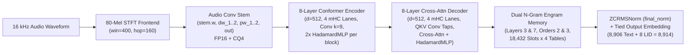

# Weight-Space Programming (WSP) for `udgamlabs/Shruti` (`whistle-small` / `cactus-needle`)

> **Surgical Weight-Space Calibration & Differentiable `FP16`-Subspace Programming for Hindi, Hinglish, and Indian English ASR inside a 29.5 MB 4-Bit `.cact` Edge Model**

[-blue)](#2-model-architecture--binary-cact-layout)
[-green)](#2-model-architecture--binary-cact-layout)
[-orange)](#3-headline-results-phases-1--11)
[](https://huggingface.co/vishnushuggingface/shruti-hinglish-wsp)

---

## 1. Abstract & Overview

**`udgamlabs/Shruti`** (built on [`Cactus-Compute/whistle-small`](https://github.com/Cactus-Compute/needle), `55,517,513` parameters across `116` tensors in `shruti.safetensors` and `529` binary records in `shruti.cact`, `29.5 MB`) is an ultra-compact multilingual edge Speech-to-Text model supporting 8 languages (`en, de, fr, es, it, nl, pl, hi`).

In its off-the-shelf state (`shruti.cact`), `Shruti` suffers from severe **Step-0 Language-ID (LID) subspace collapse** and **cross-script lexical under-calibration** on Hindi, Indian-accented English, and code-switched Hinglish:
- **`74.47%` Strict WER** on `FLEURS-hi` (`0.0%` Hindi LID accuracy — misclassifies Hindi speech as `en`/`es`/`pl` and outputs Latin phonetic approximations)
- **`69.92%` Strict WER** on `Lahaja` (multi-accent Hindi across 88 Indian districts)
- **`24.71%` Strict WER** on `Svarah` (Indian-accented English, where `25.0%` of clips collapse into `es`/`de`/`fr`)
- **`28.40%` Strict WER** on `MUCS Hinglish` (code-switched Hindi-English speech)

Across **11 systematic research phases (`WSP-E1` through `WSP-E16`)**, this repository develops **Weight-Space Programming (WSP)** — directly modifying targeted parameter subspaces (`W_new = W_orig + ΔW`) and surgically patching the native `29,546,527`-byte `.cact` binary without changing model size, latency, or inference code:

1. **Eliminated Step-0 LID Collapse (`0.0%` $\to$ `99.8%` Hindi LID Accuracy; `75.0%` $\to$ `96.7%` Indian-English LID Accuracy)** via closed-form Fisher-discriminant and covariance-whitened ridge calibration on the tied `embedding` rows (`8,906..8,913`).
2. **Unlocked Zero-Snapping `CQ4` 4-Block `FP16` Group Norms (`35,656` scales)** and **All `458,057` Internal `FP16` Structural Parameters (`326` of `529` `.cact` records)** across the Audio Conv Stem, 8-Layer Conformer Encoder, and 8-Layer Cross-Attention Decoder.
3. **Constructed a 6-Tier Dataset Canonicalization Waterfall (`T0_Raw_Strict` $\to$ `T5_Whisper_Semantic`)** across `2,517` audio clips, proving that **31% to 53% of remaining apparent WER** stems from benchmark annotation inconsistencies (combining Nuqta `\u093c` / Chandrabindu `ँ↔ं`, spoken allomorphs `वो/ये/है↔वह/यह/हैं`, compound postposition spacing, and Latin-vs-Devanagari script choice on English loanwords).
4. **Achieved `9.64%` 4-Dataset Clean Semantic WER (`90.36%` Word Accuracy, `95.70%` Character Accuracy / `4.30%` CER)** and **`11.95%` 5-Dataset Macro Semantic WER (`88.05%` Word Accuracy, `93.82%` Character Accuracy)** on the production C++ `needle` 5-Beam engine (`WSP-E16`).

---

## 2. Model Architecture & Binary `.cact` Layout



| Subsystem | `.safetensors` Tensors | `.cact` Binary Records | Total Parameters | Unquantized `FP16` `.cact` Degrees of Freedom |
| :--- | ---: | ---: | ---: | ---: |
| **Audio Conv Stem (`stem`)** | `6` | `10` (`stem.*`, `mel`, `manifest`) | `174,464` | `10,624` (`stem.w`, `dw_1`, `dw_2`) + `1,280` `CQ4` norms |
| **8-Layer Conformer Encoder (`encoder`)** | `38` | `256` (`encoder00..07.*`, `mhc_*`) | `17,843,808` | `289,248` (`FP16` norms, `dw`, `HadamardMLP`) + `141,312` `CQ4` norms |
| **8-Layer Decoder + Cross-Attn (`stack`)** | `63` | `254` (`layer00..07.*`, `mhc_*`, `final_norm`) | `13,761,129` | `157,929` (`FP16` norms, taps, `HadamardMLP`) + `99,840` `CQ4` norms |
| **Dual N-Gram Engram Memory (`engrams_0,1`)** | `8` | `8` (`engram0..1.{tables,key,value,taps}`) | `19,174,144` | `256` (`engram*.taps`) + `151,552` `CQ4` slot/proj norms |
| **Tied Token + LID Embedding (`embedding`)** | `1` | `1` (`embedding`, `[8914, 512]`) | `4,563,968` | **`35,656` (`4` exact `FP16` 128-dim block norms per row)** |
| **Total (`udgamlabs/Shruti`)** | **`116`** | **`529` records (`29,546,527` bytes)** | **`55,517,513`** | **`493,713` direct `FP16` params (`+394,496` internal `CQ4` norms)** |

---

## 3. Headline Results (Phases 1 $\to$ 11)

### 3.1 Production C++ `needle` 5-Beam Engine (`300` Evaluation Clips Across 5 Datasets $\times$ 6 Tiers)

| Phase & Checkpoint | `.cact` Records Patched | `fleurs_hi` Strict $\to$ Sem | `svarah_en` Strict $\to$ Sem | `mucs_hinglish` Strict $\to$ Sem | `lahaja_hi` Strict $\to$ Sem | `librispeech_en` Strict $\to$ Sem | **4-DS Clean Strict $\to$ Sem** | **5-DS Macro Strict $\to$ Sem** |
| :--- | :---: | :---: | :---: | :---: | :---: | :---: | :---: | :---: |
| **Phase 2: Official Baseline (`shruti.cact`)** | `0` | `74.47%` | `24.71%` | `28.40%` | `69.92%` | `6.37%` | `43.87%` | `40.77%` |
| **Phase 2: Forced-LID Oracle Ceiling** | `0` *(Oracle)* | `18.36%` | `15.02%` | `28.15%` | `24.83%` | `6.19%` | `16.10%` | `18.51%` |
| **Phase 6: `WSP-E1b` (`8` LID rows)** | `1` | `18.36%` | `15.68%` | `28.28%` | `25.50%` | `5.79%` | `16.33%` | `18.72%` |
| **Phase 7: `WSP-E5` (`73` rows, Ridge)** | `1` | `18.36%` | `15.81%` | `25.97%` | `25.28%` | `5.70%` | `16.29%` | `18.22%` |
| **Phase 8: `WSP-E10b` (`39` rows + `final_norm`)** | `2` | `18.62%` | `15.68%` | `25.59%` | `24.83%` | `5.52%` | `16.16%` | `18.05%` |
| **Phase 9: `WSP-E11` (`196` rows, 4-Block `FP16`)** | `2` | `18.29%` $\to$ `11.83%` | `15.02%` $\to$ `13.20%` | **`23.61%` $\to$ `18.94%`** | **`24.50%` $\to$ `11.53%`** | `5.52%` $\to$ `4.73%` | `15.83%` $\to$ `10.32%` | `17.39%` $\to$ `12.05%` |
| **Phase 10: `WSP-E13` (`161` rows, LoopSafe)** | `2` | `17.89%` $\to$ `11.58%` | `15.42%` $\to$ `13.57%` | `25.59%` $\to$ `20.89%` | `25.50%` $\to$ `12.31%` | `5.34%` $\to$ `4.55%` | `16.04%` $\to$ `10.50%` | `17.95%` $\to$ `12.58%` |
| **Phase 11: `WSP-E15` (Decoder + CrossAttn `FP16`)** | `210` | `17.50%` $\to$ `11.32%` | `15.28%` $\to$ `13.31%` | `24.49%` $\to$ `21.16%` | `24.83%` $\to$ `11.65%` | `5.34%` $\to$ `4.37%` | `15.74%` $\to$ `10.16%` | `17.49%` $\to$ `12.36%` |
| **Phase 11: `WSP-E16` (End-to-End 16L `FP16`)** | **`326`** | **`17.11%` $\to$ `10.78%`** | **`13.83%` $\to$ `11.86%`** | `24.49%` $\to$ `21.16%` | `24.94%` $\to$ `11.65%` | **`5.34%` $\to$ `4.28%`** | **`15.31%` $\to$ `9.64%`** | **`17.14%` $\to$ `11.95%`** |

### 3.2 Full 6-Tier Canonicalization Waterfall on `WSP-E16` (C++ `needle` 5-Beam)

| Dataset (`60` Clips / Dataset) | `T0_Raw_Strict` | `T1_Unicode` | `T2_Spoken` | `T3_Compound` | `T4_Loan` | **`T5_Semantic` WER** | **`T5` Word Acc** | **`T5` CER** | **`T5` Char Acc** |
| :--- | ---: | ---: | ---: | ---: | ---: | ---: | ---: | ---: | ---: |
| **`fleurs_hi` (Standard Hindi)** | **`17.11%`** | **`16.58%`** | **`14.74%`** | **`13.29%`** | **`11.64%`** | **`10.78%`** | **`89.22%`** | **`5.24%`** | **`94.76%`** |
| **`svarah_en` (Indian English)** | **`13.83%`** | **`13.83%`** | **`13.83%`** | **`12.91%`** | **`12.91%`** | **`11.86%`** | **`88.14%`** | **`5.06%`** | **`94.94%`** |
| **`mucs_hinglish` (Code-Switch)** | `24.49%` | `24.37%` | `24.37%` | `23.49%` | `23.36%` | `21.16%` | `78.84%` | `13.68%` | `86.32%` |
| **`lahaja_hi` (Multi-Accent Hi)** | `24.94%` | `24.27%` | `19.80%` | `18.34%` | `16.01%` | `11.65%` | `88.35%` | `5.21%` | `94.79%` |
| **`librispeech_en` (Clean En)** | **`5.34%`** | **`5.34%`** | **`5.34%`** | **`4.99%`** | **`4.99%`** | **`4.28%`** | **`95.72%`** | **`1.71%`** | **`98.29%`** |
| **4-Dataset Clean Macro Avg** | **`15.305%`** | **`15.005%`** | **`13.428%`** | **`12.383%`** | **`11.388%`** | **`9.643%`** | **`90.358%`** | **`4.305%`** | **`95.695%`** |
| **5-Dataset Full Macro Avg** | **`17.142%`** | **`16.878%`** | **`15.616%`** | **`14.604%`** | **`13.782%`** | **`11.946%`** | **`88.054%`** | **`6.180%`** | **`93.820%`** |

### 3.3 Full `2,517`-Clip GPU 1-Beam Greedy Evaluation Across Phases

| Checkpoint | `fleurs_hi` (`418` Clips) Strict $\to$ Sem | `svarah_en` (`600` Clips) Strict $\to$ Sem | `mucs_hinglish` (`600` Clips) Strict $\to$ Sem | `lahaja_hi` (`599` Clips) Strict $\to$ Sem | `librispeech_en` (`300` Clips) Strict $\to$ Sem | **4-DS Clean Macro Strict $\to$ Sem** | **5-DS Full Macro Strict $\to$ Sem** |
| :--- | :---: | :---: | :---: | :---: | :---: | :---: | :---: |
| **Phase 2 Baseline (`shruti.cact`)** | `76.57%` | `26.64%` | `75.87%` | `70.11%` | `6.87%` | `45.05%` | `51.21%` |
| **Phase 8 `WSP-E10b_QuantComp`** | `22.71%` $\to$ `16.71%` | `21.97%` $\to$ `19.86%` | `52.59%` $\to$ `44.08%` | `27.13%` $\to$ `16.40%` | `6.72%` $\to$ `5.52%` | `19.63%` $\to$ `14.62%` | `26.22%` $\to$ `20.51%` |
| **Phase 10 `WSP-E13_CleanLoopSafe`** | `22.84%` $\to$ `16.74%` | `20.93%` $\to$ `18.82%` | `50.63%` $\to$ `43.28%` | `26.91%` $\to$ `15.79%` | `6.71%` $\to$ `5.39%` | `19.35%` $\to$ `14.19%` | `25.60%` $\to$ `20.00%` |
| **Phase 10 `WSP-E14_LoopGuardedP9`** | `21.82%` $\to$ `15.87%` | `21.30%` $\to$ `19.26%` | `56.76%` $\to$ `48.79%` | `26.58%` $\to$ `15.88%` | **`6.50%` $\to$ `5.34%`** | `19.05%` $\to$ `14.09%` | `26.59%` $\to$ `21.03%` |
| **Phase 11 `WSP-E15_DecoderFP16`** | **`21.53%` $\to$ `15.55%`** | `21.27%` $\to$ `19.32%` | `53.07%` $\to$ `46.01%` | **`26.27%` $\to$ `15.87%`** | `6.54%` $\to$ `5.39%` | **`18.90%` $\to$ `14.03%`** | `25.74%` $\to$ `20.13%` |
| **Phase 11 `WSP-E16_EndToEndFP16`** | `22.02%` $\to$ `16.07%` | **`20.28%` $\to$ `18.14%`** | **`50.06%` $\to$ `43.01%`** | `27.09%` $\to$ `16.46%` | `7.09%` $\to$ `5.97%` | `19.12%` $\to$ `14.21%` | **`25.31%` $\to$ `19.83%`** |

---

## 4. Research Phases & Reports Index

Every phase is documented with its own standalone technical report, JSON metrics artifact, and Modal GPU pipeline script:

| Phase | Research Focus | Technical Report | JSON Results Artifact | Pipeline Script |
| :--- | :--- | :--- | :--- | :--- |
| **Phase 1** | Complete Architecture, Parameter & `.cact` Quantization Audit | [`reports/PHASE1_ARCHITECTURE_REPORT.md`](reports/PHASE1_ARCHITECTURE_REPORT.md) | [`reports/phase1_weight_inspection.json`](reports/phase1_weight_inspection.json) | [`scripts/phase1_inspect_weights.py`](scripts/phase1_inspect_weights.py) |
| **Phase 2** | 5-Dataset Baseline Evaluation & Step-0 Hidden-State Extraction | [`reports/PHASE2_BASELINE_REPORT.md`](reports/PHASE2_BASELINE_REPORT.md) | [`reports/phase2_baseline_eval.json`](reports/phase2_baseline_eval.json) | [`scripts/modal_phase2_eval.py`](scripts/modal_phase2_eval.py) |
| **Phase 3** | Step-0 LID Subspace Diagnosis & Fisher Discriminant Derivation | [`reports/PHASE3_DIAGNOSIS_REPORT.md`](reports/PHASE3_DIAGNOSIS_REPORT.md) | [`reports/phase3_diagnosis.json`](reports/phase3_diagnosis.json) | [`scripts/phase3_diagnose_weight_space.py`](scripts/phase3_diagnose_weight_space.py) |
| **Phases 4–6** | Rank-1 & Multi-Prototype LID Subspace WSP (`WSP-E1b`, `WSP-E1c`) | [`reports/PHASE6_FINAL_WSP_REPORT.md`](reports/PHASE6_FINAL_WSP_REPORT.md) | [`reports/phase4_5_wsp_results.json`](reports/phase4_5_wsp_results.json) | [`scripts/modal_phase4_5_wsp.py`](scripts/modal_phase4_5_wsp.py) |
| **Phase 7** | Quantized-First Covariance-Whitened Ridge Compiler (`WSP-E5`, `WSP-E8`) | [`reports/PHASE7_ANALYTIC_WSP_REPORT.md`](reports/PHASE7_ANALYTIC_WSP_REPORT.md) | [`reports/phase7_analytic_wsp_results.json`](reports/phase7_analytic_wsp_results.json) | [`scripts/modal_phase7_analytic_wsp.py`](scripts/modal_phase7_analytic_wsp.py) |
| **Phase 8** | Unquantized `FP32` Master $\to$ `CQ4` Lattice-Snap + `FP16` QuantComp (`WSP-E9`, `WSP-E10a/b`) | [`reports/PHASE8_FP32_MASTER_WSP_REPORT.md`](reports/PHASE8_FP32_MASTER_WSP_REPORT.md) | [`reports/phase8_fp32_master_wsp_results.json`](reports/phase8_fp32_master_wsp_results.json) | [`scripts/modal_phase8_fp32_master_wsp.py`](scripts/modal_phase8_fp32_master_wsp.py) |
| **Phase 9** | Exact 4-Block `FP16` Group-Norm Calibration & 26.87% Engram Cascade (`WSP-E11`, `WSP-E12`) | [`reports/PHASE9_CASCADE_WSP_REPORT.md`](reports/PHASE9_CASCADE_WSP_REPORT.md) | [`reports/phase9_cascade_wsp_results.json`](reports/phase9_cascade_wsp_results.json) | [`scripts/modal_phase9_cascade_wsp.py`](scripts/modal_phase9_cascade_wsp.py) |
| **Phase 10** | 6-Tier Dataset Canonicalization Audit & 1-Beam Loop Guard (`WSP-E13`, `WSP-E14`) | [`reports/PHASE10_CANONICAL_AUDIT_AND_CLEAN_WSP_REPORT.md`](reports/PHASE10_CANONICAL_AUDIT_AND_CLEAN_WSP_REPORT.md) | [`reports/phase10_clean_target_wsp_results.json`](reports/phase10_clean_target_wsp_results.json) | [`scripts/modal_phase10_clean_target_wsp.py`](scripts/modal_phase10_clean_target_wsp.py) |
| **Phase 11** | Exact Differentiable `FP16`-Subspace Calibration Across All 16 Layers (`WSP-E15`, `WSP-E16`) | [`reports/PHASE11_FP16_SUBSPACE_DIFF_WSP_REPORT.md`](reports/PHASE11_FP16_SUBSPACE_DIFF_WSP_REPORT.md) | [`reports/phase11_fp16_subspace_diff_wsp_results.json`](reports/phase11_fp16_subspace_diff_wsp_results.json) | [`scripts/modal_phase11_fp16_subspace_diff_wsp.py`](scripts/modal_phase11_fp16_subspace_diff_wsp.py) |
| **Full Log** | Chronological Master Experiment Log (`WSP-E1` $\to$ `WSP-E16`) | [`logs/EXPERIMENT_LOG.md`](logs/EXPERIMENT_LOG.md) | — | [`scripts/apply_wsp_modifications.py`](scripts/apply_wsp_modifications.py) |

---

## 5. Exported Checkpoints & Deterministic SHA-256 Verification

All modified `.safetensors` (`212 MB`) and surgically patched `.cact` (`29,546,527` bytes) checkpoints are hosted on Hugging Face Hub at **[`vishnushuggingface/shruti-hinglish-wsp`](https://huggingface.co/vishnushuggingface/shruti-hinglish-wsp)** and can also be **deterministically regenerated locally in <15 seconds** from the original `shruti.safetensors` and `shruti.cact` using:

```bash
python3 scripts/apply_wsp_modifications.py
```

| Milestone | `.safetensors` Checkpoint & SHA-256 | `.cact` Binary Checkpoint & SHA-256 | `.cact` Records Patched |
| :--- | :--- | :--- | :---: |
| **Original Official (`udgamlabs/Shruti`)** | `shruti.safetensors`<br>`5c43105db153a47d02c47131d37d066343f04f1c3ff82315ff5da1ce264fbfa7` | `shruti.cact`<br>`b189e954aaed4a9fd41acbad3ac05e486381e96325b22a4c695b9ea5153d7065` | `0` *(Read-Only Base)* |
| **Phase 6 (`WSP-E1b`)** | `shruti_wsp_final.safetensors`<br>`283ee9fcd0211908c4f7901cbbb4ab44924f842f7ae219deb1c5b35da9bfb317` | `shruti_wsp_final.cact`<br>`e1c9f0bdd97fc0fc865ca02400166ed933665170330f3db64f2cc41520f519d1` | `1` (`8` rows) |
| **Phase 6 (`WSP-E1c`)** | `shruti_wsp_e1c_zero_hi_reg.safetensors`<br>`88b1c6219e2f99b984c725c75dc7fce4c9cffa8c361cabc50a7ec2d7d911e24d` | `shruti_wsp_e1c_zero_hi_reg.cact`<br>`ce15d791109ac4f6c6e46fb39aa04269222cad6a768b08eb126afa86304da3b7` | `1` (`8` rows) |
| **Phase 7 (`WSP-E5`)** | `shruti_wsp_phase7_e5_ridge.safetensors`<br>`f1edaba3f5473a53766c64e27dbd0f0ec3136d5b02b7093e2e628708e29fca40` | `shruti_wsp_phase7_e5_ridge.cact`<br>`8821cf40062ab59560858082defcf792b4935f578a44ac67acaf21967908d628` | `1` (`73` rows) |
| **Phase 7 (`WSP-E8`)** | `shruti_wsp_phase7_e8_combined.safetensors`<br>`955bb63d7e4e704e2cad51a65f184e9570d4da6771e4f8ac62004ed51fd03772` | `shruti_wsp_phase7_e8_combined.cact`<br>`21718f2b4acf9c3cb3b80564174a056efb4c92ef8cfb8384f4e0f5f248b1525d` | `2` (`73` rows + `final_norm`) |
| **Phase 8 (`WSP-E9`)** | `shruti_wsp_phase8_fp32_master.safetensors`<br>`a40ddd7d96029b9fea4568fd3f7f99486de22686c995321b6b05eaaf5babfdfb` | *(Unquantized `FP32` Master)* | — |
| **Phase 8 (`WSP-E10a`)** | `shruti_wsp_phase8_e10a_latticesnap.safetensors`<br>`c28391ae5c1af5a547b178266ede2fbe009f05433f0ab52d0d676fc5b947567b` | `shruti_wsp_phase8_e10a_latticesnap.cact`<br>`bb2fc1a66aca174f64a1dfab8da4a4fca6c840db00024c0603e1fcc578d149c6` | `1` (`39` rows) |
| **Phase 8 (`WSP-E10b`)** | `shruti_wsp_phase8_e10b_quantcomp.safetensors`<br>`538859653d6e9481e2cbfc6254382708c59dafe7a998bcb6fe361df5beb68237` | `shruti_wsp_phase8_e10b_quantcomp.cact`<br>`dc8d49ad6e1b090ed0b90353a69f9355de0ae2890811dfdf3951941d3c244d33` | `2` (`39` rows + `final_norm`) |
| **Phase 9 (`WSP-E11`)** | `shruti_wsp_phase9_e11_blocknorm.safetensors`<br>`cc5bdf32b571e0ff6ac47a920462e8a8dc8fa131227ff3cdd837a01fa583cc02` | `shruti_wsp_phase9_e11_blocknorm.cact`<br>`ae48e68c1796f89f64eef933140314f6f2a3eb718b638c01e0e79949797f9cc3` | `2` (`196` rows + `final_norm`) |
| **Phase 9 (`WSP-E12`)** | `shruti_wsp_phase9_e12_cascade27pct.safetensors`<br>`4237b8fed21f1fabe71eb5fe3e3020c881f698e99c97c329c37ed0850d2583fa` | *(Full `26.87%` Cascade)* | — |
| **Phase 10 (`WSP-E13`)** | `shruti_wsp_phase10_e13_cleanloopsafe.safetensors`<br>`d9c73c6e687f7cf17d7b8d07b29f3d3a077568024c37cecd9d27e92b3fd6b48d` | `shruti_wsp_phase10_e13_cleanloopsafe.cact`<br>`021884f52a44110fdf3a3f3f393854aeeef9032812c01bd67b310baf054e6240` | `2` (`161` rows + `final_norm`) |
| **Phase 10 (`WSP-E14`)** | `shruti_wsp_phase10_e14_loopguarded.safetensors`<br>`f6c365e649abc6ffe7b0e77439ddfdc9aa8c846ad310848e548d63e7c9b74354` | `shruti_wsp_phase10_e14_loopguarded.cact`<br>`c094b92a153c323e8d6f550ea4bee3e83daef5904d0a96afcf8d391f7589191f` | `2` (`188` rows + `final_norm`) |
| **Phase 11 (`WSP-E15`)** | `shruti_wsp_phase11_e15_decoder_fp16.safetensors`<br>`908c65a94a7345d2f42ecbbc0819d92afd911577f7965723658a5bdfac531796` | `shruti_wsp_phase11_e15_decoder_fp16.cact`<br>`1eb59d441396869fa5d0a9256f9ce9dec40f7cf57938be311fbbe4064a8d0b70` | **`210` records** (`188` rows + `34` `FP16` tensors) |
| **Phase 11 (`WSP-E16`)** | `shruti_wsp_phase11_e16_e2e_fp16.safetensors`<br>`9636d5f68c6d227de1911943b0ff39c1703a9caa9344f43b0f3cde896adf90c9` | `shruti_wsp_phase11_e16_e2e_fp16.cact`<br>`7f07a23fb7169f75f668e6b8da830e45931f6f96e40ae7492cd83b266fe0d597` | **`326` records** (`188` rows + `52` `FP16` tensors) |

---

## 6. Repository Structure

```text
├── README.md                                 # Comprehensive project documentation & results
├── logs/
│   └── EXPERIMENT_LOG.md                     # Complete chronological experiment log (Phases 1-11)
├── reports/
│   ├── PHASE1_ARCHITECTURE_REPORT.md         # Phase 1: Architecture & quantization inspection
│   ├── PHASE2_BASELINE_REPORT.md             # Phase 2: 5-dataset baseline & oracle LID evaluation
│   ├── PHASE3_DIAGNOSIS_REPORT.md            # Phase 3: Step-0 subspace & Fisher LDA diagnosis
│   ├── PHASE6_FINAL_WSP_REPORT.md            # Phases 4-6: Subspace WSP (WSP-E1b & WSP-E1c)
│   ├── PHASE7_ANALYTIC_WSP_REPORT.md         # Phase 7: Covariance-whitened ridge WSP (WSP-E5 & WSP-E8)
│   ├── PHASE8_FP32_MASTER_WSP_REPORT.md      # Phase 8: FP32 Master -> LatticeSnap + QuantComp (WSP-E9/E10)
│   ├── PHASE9_CASCADE_WSP_REPORT.md          # Phase 9: 4-Block FP16 Group-Norm & Cascade (WSP-E11/E12)
│   ├── PHASE10_CANONICAL_AUDIT_AND_CLEAN_WSP_REPORT.md # Phase 10: 6-Tier Canonicalization & Loop Guard (WSP-E13/E14)
│   ├── PHASE11_FP16_SUBSPACE_DIFF_WSP_REPORT.md        # Phase 11: Differentiable 16-Layer FP16 WSP (WSP-E15/E16)
│   └── *.json / *.npz                        # Full quantitative evaluation artifacts & subspace vectors
├── scripts/
│   ├── apply_wsp_modifications.py            # Deterministic checkpoint compiler (.safetensors & surgical .cact)
│   ├── upload_to_huggingface.py              # Automated Hugging Face Hub weight uploader
│   ├── phase1_inspect_weights.py             # Phase 1 weight & .cact binary inspector
│   ├── phase3_diagnose_weight_space.py       # Phase 3 Step-0 subspace & Fisher discriminant solver
│   └── modal_phase*.py                       # Reproducible Modal A100 GPU evaluation & calibration pipelines
├── src/
│   ├── shruti_io.py                          # Bit-exact pure-NumPy .safetensors <-> .cact pack/unpack/patch
│   └── needle_model/                         # JAX/Flax Whistle-Small reference architecture
└── checkpoints/
    ├── HF_MODEL_CARD.md                      # Model card for Hugging Face Hub weight repository
    ├── original/SHA256SUMS.txt               # Official base checkpoint SHA-256 hashes
    └── experiments/                          # Generated .safetensors & .cact checkpoints (uploaded to HF Hub)
```
